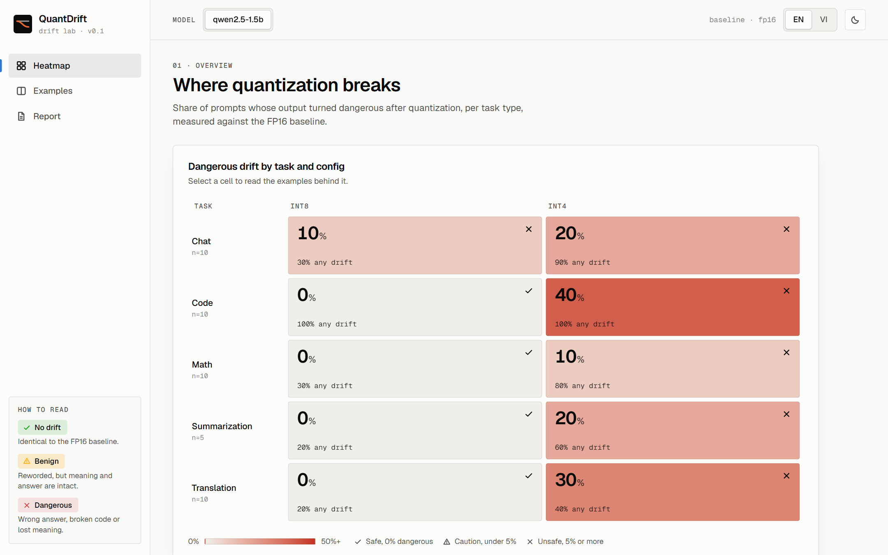

# QuantDrift

**Measuring how quantization breaks LLM output, per task type.**

Quantization (FP16 → INT8 → INT4) shrinks a model and speeds it up, but it also changes what
the model says. QuantDrift runs the same prompts at each precision, compares every output with
the FP16 baseline using a check suited to the task, and tells you which tasks survived and
which did not.



## The problem

You quantize a model from FP16 to INT4, try a few prompts, and it "looks fine." Later you find
the math is occasionally wrong and the code behaves differently, while the translations still
read well. Quantization does not break everything equally, and a handful of spot checks will
not tell you where it breaks.

## What it does

1. Runs one prompt set across several quantization configs.
2. Compares each output with the FP16 output for the same prompt, using a task-specific check.
3. Classifies each pair as **no drift**, **benign** (reworded, same answer or behavior) or
   **dangerous** (wrong answer, changed code behavior, syntax error, changed meaning).
4. Reports a safe / caution / unsafe verdict per task type and config, with the examples behind it.

## Result from the shipped run

Qwen2.5-1.5B-Instruct on a laptop CPU (llama.cpp), 45 prompts, compared with FP16. Share of
prompts whose output turned **dangerous**:

| Task | INT8 (Q8_0) | INT4 (Q4_K_M) |
|---|---|---|
| Chat | 10% | 20% |
| Code | **0%** | **40%** |
| Math | **0%** | 10% |
| Summarization | 0% | 20% |
| Translation | 0% | 30% |

- **INT8:** every code answer is reworded (100% any drift) yet none changes behavior, which is
  the distinction this tool exists to make. Its one dangerous flag (chat) is a borderline
  paraphrase on manual reading.
- **INT4:** 4 of 10 programs change behavior and `17 * 24` comes out as 336 instead of 408.
- **Speed on this CPU:** 9.5 tok/s (FP16), 13.8 (INT8), 18.8 (INT4). File size 3.56 GB, 1.89 GB, 1.12 GB.

> **Read this before quoting the numbers.** It is one small model, 45 prompts (5 to 10 per
> task type) and a single greedy run, so a single prompt moves a cell by 10 to 20 points.
> The math and code columns come from deterministic checks. The chat, summarization and
> translation columns come from an embedding-similarity threshold; of the 5 such flags reviewed
> by hand, 1 was a real error and 4 were borderline. Treat them as an upper bound. "INT8" and
> "INT4" are llama.cpp's Q8_0 and Q4_K_M formats. Details, the full table and the
> cases checked by hand are in [docs/benchmark-report.md](docs/benchmark-report.md).

## Why task-specific checks

Embedding similarity measures closeness of topic, not correctness. With `all-MiniLM-L6-v2`,
`"The answer is 391."` and `"The answer is 361."` score **0.884**, above the 0.85 cutoff for a
harmless paraphrase. So QuantDrift checks each task on its own terms:

| Task | Check |
|---|---|
| Math | Extract the final numeric answer from both outputs and compare the numbers. |
| Code | Parse both programs, run them in a subprocess on a fixed set of inputs, and compare return values and in-place changes. |
| Translation, summarization, chat | Embedding similarity with per-task thresholds. |

Drift is measured against the FP16 output, not against ground truth. See
[docs/algorithm.md](docs/algorithm.md) for the full rules and thresholds.

## Quick start

### See the dashboard (Docker)

```bash
git clone https://github.com/nguyenhoangkhang-2010/quant-drift.git
cd quant-drift
docker compose up --build
```

Open http://localhost:3000 (set `DASHBOARD_PORT` if that port is taken). The first build
downloads CPU-only PyTorch and the embedding model, so it takes a few minutes. The repo ships
the Qwen2.5-1.5B results, so the dashboard has data immediately. The first heatmap request can
take up to a minute or two while the analyzer loads its embedding model.

### Run without Docker

```bash
pip install -r analyzer/requirements.txt
uvicorn analyzer.src.api:app --port 8000

cd dashboard && npm install && npm run dev      # http://localhost:3000
```

### Reproduce or extend the benchmark

Needs Python 3.10+, about 7 GB of disk and 30 to 45 minutes on a laptop CPU. `llama-cpp-python`
compiles from source unless a prebuilt wheel is available for your platform.

```bash
pip install -r runner/requirements.txt
bash scripts/run_full_benchmark.sh qwen2.5-1.5b     # downloads the GGUF files, then benchmarks
```

That writes `results/qwen2.5-1.5b/{fp16,int8,int4}.json`. To benchmark another model, add an
entry to `PRESETS` in `scripts/download_gguf.py` (Hugging Face repo plus the three GGUF file
names) and pass its name to the script.

### Tests

```bash
pip install -r requirements-dev.txt
pytest
```

## Architecture

```
prompts/ ──▶ runner/ ──▶ results/ ──▶ analyzer/ ──▶ dashboard/
(45 prompts)  (inference    (raw JSON    (drift          (heatmap, examples,
              per config)    outputs)     classification)  report)
```

A file-based pipeline: the runner writes JSON, the analyzer (FastAPI) reads it, the dashboard
(React, Vite, Recharts) calls the analyzer. More in [docs/architecture.md](docs/architecture.md).

## Project structure

```
quant-drift/
├── runner/          # Inference across quantization configs (llama.cpp, Transformers, ONNX Runtime backends)
├── analyzer/        # FastAPI service: verifiers, classifier, statistics
├── dashboard/       # React dashboard (English / Vietnamese, light / dark)
├── prompts/         # 45 prompts: chat, code, math, summarization, translation
├── configs/         # Quantization configs (configs/gguf/ is the CPU set used for the shipped run)
├── results/         # The committed Qwen2.5-1.5B run
├── tests/           # pytest suite
├── docs/            # Architecture, algorithm, benchmark report, screenshots
└── scripts/         # Model download and benchmark scripts
```

## Backends and models

The shipped results use **llama.cpp (GGUF)** only. The runner also has Hugging Face
Transformers and ONNX Runtime backends behind the same interface; they are implemented but have
not been exercised in a published run. Any model with FP16, Q8_0 and Q4_K_M GGUF files works
with the scripts above.

`scripts/generate_sample_results.py` creates synthetic data for two made-up models for UI
development. It is not part of the committed results.

## Known limitations

- Small prompt set, one model, one run; no confidence intervals.
- Semantic thresholds (0.95 / 0.85 / 0.80) are hand-picked and uncalibrated, and the embedding
  model is English-centric.
- The "caution" band (under 5% dangerous) cannot occur with fewer than 20 prompts per cell.
- Outputs are capped at 512 tokens, so a truncated answer can look like drift.
- Generated code is run in a subprocess with a timeout. That guards against runaway loops and
  is not a security sandbox.

## License

MIT
