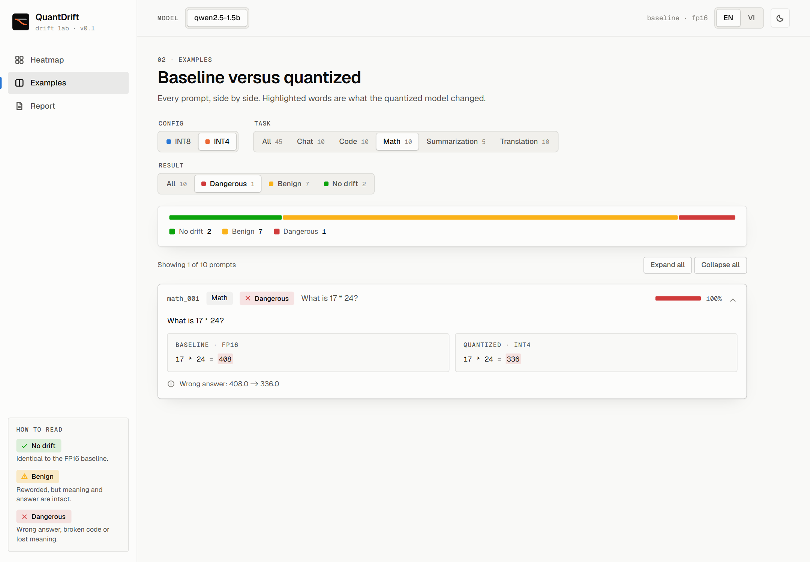

# Architecture

```
prompts/*.jsonl ─┐
configs/*.yaml  ─┼─▶ runner ──▶ results/<model>/<config>.json ──▶ analyzer (FastAPI) ──▶ dashboard
models/*.gguf   ─┘   (inference)      (raw outputs)                 (drift classification)   (React)
```

The pipeline is deliberately file-based: the runner writes plain JSON, the analyzer reads it,
and nothing needs a database. A benchmark run can be committed, diffed and shipped with the repo.

## Components

### Runner (`runner/`)

Runs every prompt through every config and writes one JSON file per config.

- `src/benchmark.py`: the CLI. Loads prompts from `prompts/*.jsonl`, loads each YAML config,
  generates, and writes `results/<model>/<config>.json` as soon as a config finishes (so a crash
  in a later config does not lose earlier ones). One failing prompt is recorded as an
  `ERROR: ...` output instead of aborting the run.
- `src/config.py`: parses a config YAML. `model_path` may contain `{model}`, which is
  replaced by the `--model` name, so one set of configs serves any model.
- `src/backends/`: one class per runtime behind a common `generate(prompt, ...)` interface.
  `llamacpp.py` (GGUF through llama.cpp) produced the published results. `transformers_backend.py`
  and `onnx_backend.py` implement the same interface but were not exercised in the published run.

Configs live in `configs/gguf/` (the CPU llama.cpp set used for the shipped run) and in
`configs/` (Transformers-style FP16 / INT8 / INT4 definitions).

### Analyzer (`analyzer/`)

A FastAPI service that compares each quantized config with the FP16 baseline.

- `src/drift_detector.py`: loads two result files, pairs outputs by `prompt_id`, and asks the
  classifier about each pair.
- `src/classifier.py`: dispatches on category (see [algorithm.md](algorithm.md)).
- `src/verifiers/`: `math_verifier.py`, `code_verifier.py`, `semantic_verifier.py`
  (and a thin `translation_verifier.py`).
- `src/statistics.py`: per-task rates, the safe / caution / unsafe verdict, and the
  human-readable recommendations.
- `src/api.py`: the HTTP layer.

| Endpoint | Returns |
|---|---|
| `GET /api/models` | Model names found under `results/` |
| `GET /api/models/{model}/configs` | Config names for a model |
| `GET /api/models/{model}/heatmap` | One cell per (config, task type): totals, drift rate, dangerous rate, verdict |
| `GET /api/models/{model}/drift/{config}` | Summary counts plus every classified prompt |
| `GET /api/models/{model}/examples/{config}?category=&drift_type=` | Filtered prompt pairs (first 50) |
| `GET /api/models/{model}/recommendations` | Plain-language safe / caution / unsafe lines |

`RESULTS_DIR` (default `results`) selects where models are read from.

Three decisions keep it responsive:

- **Cached detection.** `DriftDetector.detect` caches its result keyed by the modification
  time of the baseline and quantized files, so a re-run benchmark invalidates it automatically
  and every other request is served from memory.
- **Warm start.** On startup a background thread loads the embedding model, so the first
  user request does not pay for the import and model load. The model itself is cached at
  module level behind a lock.
- **Out-of-process code execution.** Generated code runs in a subprocess with a timeout rather
  than in a thread, so a runaway program is killed instead of leaking a spinning thread that
  starves the API.

### Dashboard (`dashboard/`)

React, Vite and Recharts, served by nginx in Docker (which also proxies `/api/` to the analyzer).

- Pages: **Heatmap** (task type by config, click a cell to drill into its examples),
  **Examples** (baseline and quantized output side by side with a word-level diff, filters
  synced to the URL), **Report** (the deployment guide and risk ranking).
- `src/i18n.tsx`: English and Vietnamese dictionaries, language chosen from the browser
  and persisted. `src/hooks.ts` and `src/context.tsx` hold the theme (light / dark, following the
  OS until the user chooses) and the model selection.
- Colour comes from CSS tokens in `src/index.css`. The heat scale is a single hue with a
  fixed 0 to 50% domain so cells are comparable across models, and verdict colours are always
  paired with an icon and a label.



## Result file format

`results/<model>/<config>.json` is a list with one object per prompt:

```json
{
  "prompt_id": "math_001",
  "prompt_text": "What is 17 * 24?",
  "category": "math",
  "config_name": "int4",
  "output": "17 * 24 = 336",
  "latency_ms": 1234.5,
  "tokens_generated": 12
}
```

The model name is the directory name, which is why `--model` is a flat name such as
`qwen2.5-1.5b` and not a Hugging Face path with a slash. `fp16.json` is the baseline and must
exist for the analyzer to work.

## Deployment

`docker-compose.yml` runs two containers: `analyzer` (Python 3.12, CPU-only torch, the
embedding model baked into the image, `results/` mounted read-only) and `dashboard` (a Node
build served by nginx). The dashboard waits for the analyzer's healthcheck. Set
`DASHBOARD_PORT` if port 3000 is taken.

## Testing

`tests/` has a pytest suite for the verifiers, classifier, detector, statistics and API. The
embedding model is stubbed in tests, so the suite runs in seconds with no model download.
`tests/test_real_results.py` also pins a few facts about the committed Qwen run so the shipped
data and the verifiers cannot drift apart unnoticed. CI runs ruff, pytest, the dashboard type
check and build, and `docker compose build`.
