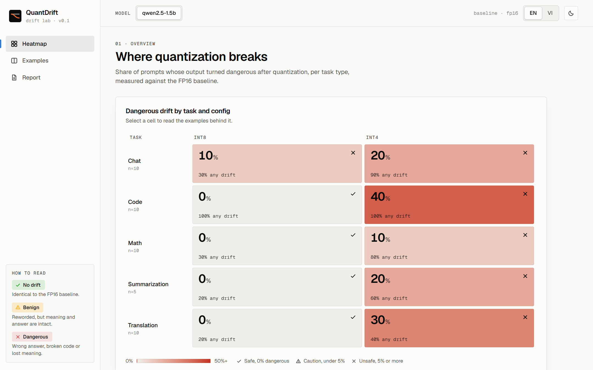

# Benchmark report: Qwen2.5-1.5B-Instruct, FP16 vs INT8 vs INT4

This is the one real run shipped with the repo (`results/qwen2.5-1.5b/`). Everything below
can be regenerated with `scripts/run_full_benchmark.sh` and read back through the dashboard.

> **Scope, in one line:** one small model, 45 prompts, one greedy run per config, on a CPU.
> Treat the numbers as a worked example of the method, not as a general statement about
> quantization.

## Setup

| | |
|---|---|
| Model | `Qwen/Qwen2.5-1.5B-Instruct` (GGUF files from `Qwen/Qwen2.5-1.5B-Instruct-GGUF`) |
| Runtime | llama.cpp through `llama-cpp-python` 0.3.36, CPU only (`n_gpu_layers: 0`) |
| Hardware | Intel Core i7-12700H (14 cores / 20 threads), 40 GB RAM, Windows 11, no discrete GPU |
| Decoding | chat completion, `temperature 0.0`, `seed 42`, `max_tokens 512`, `n_ctx 2048` |
| Prompts | 45: chat 10, code 10, math 10, translation 10, summarization 5 |
| Baseline | FP16; every other config is compared against it, prompt by prompt |

### What "INT8" and "INT4" mean here

The configs are named `fp16`, `int8` and `int4`, but the files are llama.cpp GGUF quantizations:

| Config | GGUF type | File size | vs FP16 |
|---|---|---|---|
| `fp16` | F16 | 3.56 GB | 1.0x |
| `int8` | Q8_0 | 1.89 GB | 1.9x smaller |
| `int4` | Q4_K_M | 1.12 GB | 3.2x smaller |

Q4_K_M is a mixed-precision 4-bit scheme (some tensors keep more bits), not plain
round-to-nearest INT4. Results for a different INT4 method (GPTQ, AWQ, bitsandbytes) can differ.

## Speed (CPU)

| Config | Tokens generated | Wall time | Throughput | Prompts that hit the 512-token cap |
|---|---|---|---|---|
| fp16 | 8,506 | 894 s | 9.5 tok/s | 3 |
| int8 | 8,346 | 607 s | 13.8 tok/s | 0 |
| int4 | 8,530 | 454 s | 18.8 tok/s | 2 |

On this CPU, generation is memory-bandwidth bound, so smaller weights are faster: INT4 is
about 2x FP16. Each number comes from a single run on a laptop, so read the ratios, not the
third digit.

## Drift against the FP16 baseline

Percentages are the share of prompts in that task type. "Dangerous" is the headline number;
"any drift" counts benign paraphrases too.

| Task | n | INT8 any drift | INT8 dangerous | INT4 any drift | INT4 dangerous |
|---|---|---|---|---|---|
| Chat | 10 | 30% | 10% | 90% | 20% |
| Code | 10 | 100% | **0%** | 100% | **40%** |
| Math | 10 | 30% | **0%** | 80% | 10% |
| Summarization | 5 | 20% | 0% | 60% | 20% |
| Translation | 10 | 20% | 0% | 40% | 30% |
| **All** | 45 | 42% (19/45) | 2.2% (1/45) | 76% (34/45) | 24.4% (11/45) |

Per-prompt split: INT8 has 26 identical, 18 benign, 1 dangerous. INT4 has 11 identical,
23 benign, 11 dangerous.



### Reading the table

- **INT8 (Q8_0) is effectively harmless on this set.** Its code answers differ in text on
  every prompt (100% any drift) but behave identically on all of them, which is exactly the
  distinction the tool exists to make. Its single dangerous flag is a borderline one (below).
- **INT4 (Q4_K_M) visibly degrades code.** 4 of 10 programs change behavior.
- **Every INT4 task type crosses the 5% "unsafe" line**, but see the next section before
  reading that as "unsafe everywhere".

## The dangerous cases, checked by hand

Math and code are decided by deterministic checks, so those flags are trustworthy. The
semantic categories (chat, summarization, translation) are decided by an embedding
similarity threshold, which is a heuristic. The flagged examples were reviewed by hand:

| Prompt | Config | Verdict from the tool | After reading it |
|---|---|---|---|
| `math_001` "What is 17 * 24?" | INT4 | Wrong answer 408 → 336 | **Real error.** |
| `code_001` Fibonacci | INT4 | Different behavior | **Real change:** FP16 returns `fib(10) = 34`, INT4 returns 55 (different index convention). |
| `code_004` reverse a list | INT4 | Different behavior | **Real change:** the prompt says to represent the list as a Python list. FP16 does; INT4 ignores that and builds its own `ListNode` class, so its function cannot take a list at all. |
| `code_005` two-sum | INT4 | Different behavior | **Real change:** FP16 returns the numbers `(2, 7)`, INT4 returns the indices `(0, 1)`. |
| `code_010` bubble sort | INT4 | Different behavior | **Real change:** FP16 returns the sorted list, INT4 sorts in place and returns `None`. |
| `trans_010` Vietnamese | INT4 | Meaning changed (0.598) | **Real error:** "Data science" became "Đầu tư dữ liệu" ("data investment"). |
| `trans_004` Japanese | INT4 | Meaning changed (0.283) | **Not a real error.** INT4's translation is clean; FP16 added romanization and an English sentence, which is what lowered the similarity. |
| `trans_006` Italian | INT4 | Meaning changed (0.793) | **Borderline.** "stazione ferroviaria" vs "stazione di treni": both correct, just under the 0.80 cutoff. |
| `sum_005` summary | INT4 | Significant drift (0.846) | **Borderline.** Both are valid one-sentence summaries, just under the 0.85 cutoff. |
| `chat_003` binary search | INT8 | Significant drift (0.816) | **Borderline.** Both explanations are correct. |
| `chat_001`, `chat_010` | INT4 | Significant drift (0.748, 0.763) | Not reviewed. |

Of the 5 similarity-based flags reviewed, 1 is a real error and 4 are borderline or
formatting differences. So the semantic columns above are an **upper bound**; the math and
code columns are not. In particular, INT8's "10% dangerous chat" is one borderline
paraphrase, and the honest summary for INT8 is "no confirmed dangerous drift".

## Limitations

- **Small sample.** 5 to 10 prompts per task type: one prompt moves a cell by 10 to 20
  points, and there are no confidence intervals. Differences between neighbouring cells are
  not meaningful.
- **One model, one run.** Decoding is greedy with a fixed seed, so reruns should match, but
  there is no variance estimate across seeds, models or prompt phrasings.
- **Drift, not accuracy.** Everything is measured against the FP16 output, not against ground
  truth. If FP16 is wrong and INT4 happens to be right, that still counts as drift. The prompts
  carry `expected_output` fields, but the analyzer does not use them.
- **Semantic thresholds are uncalibrated.** The 0.95, 0.85 and 0.80 cutoffs were chosen by
  hand, and `all-MiniLM-L6-v2` is an English-centric model, so similarity is least reliable on
  non-Latin scripts and on outputs with different formatting.
- **The 5% "caution" band is unreachable here.** With 10 prompts per cell, a single dangerous
  prompt is already 10%, so a cell is either "safe" (0) or "unsafe" (10+). The caution level
  only appears with more than 20 prompts per cell.
- **512-token cap.** Verbose answers can be cut off (3 FP16 and 2 INT4 answers hit the cap).
  A truncated answer can look like drift.
- **Quantization method.** Q8_0 and Q4_K_M, as described above.

## Reproducing

```bash
python scripts/download_gguf.py qwen2.5-1.5b          # ~6.6 GB of GGUF files into models/
bash scripts/run_full_benchmark.sh qwen2.5-1.5b       # 30-45 minutes on a laptop CPU
```

Adding another model is one entry in `PRESETS` in `scripts/download_gguf.py` plus a run.

`scripts/generate_sample_results.py` produces clearly synthetic data for two made-up models
(for UI development). It is not part of the committed results, and `results/` only tracks
the real Qwen run.
